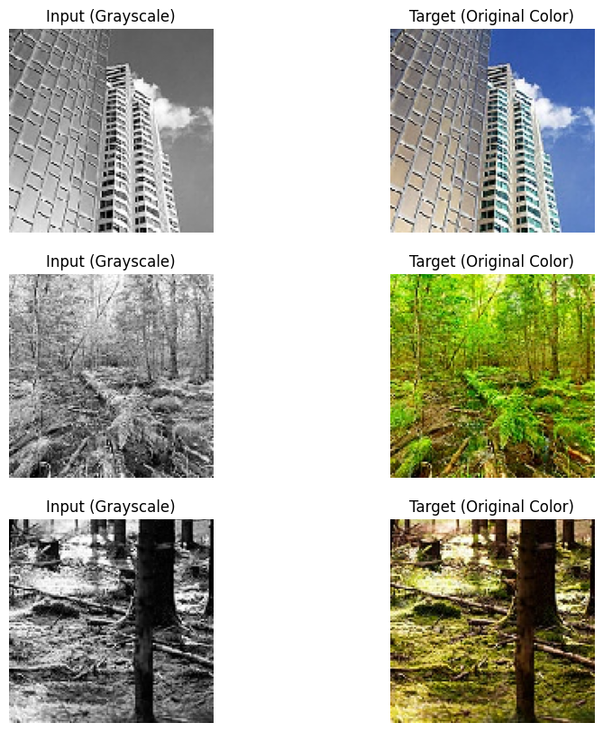
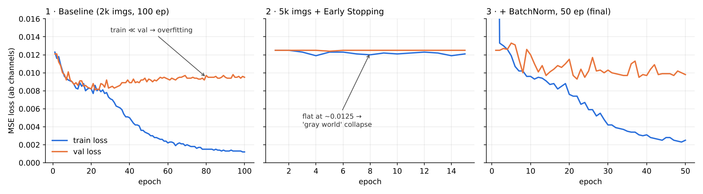
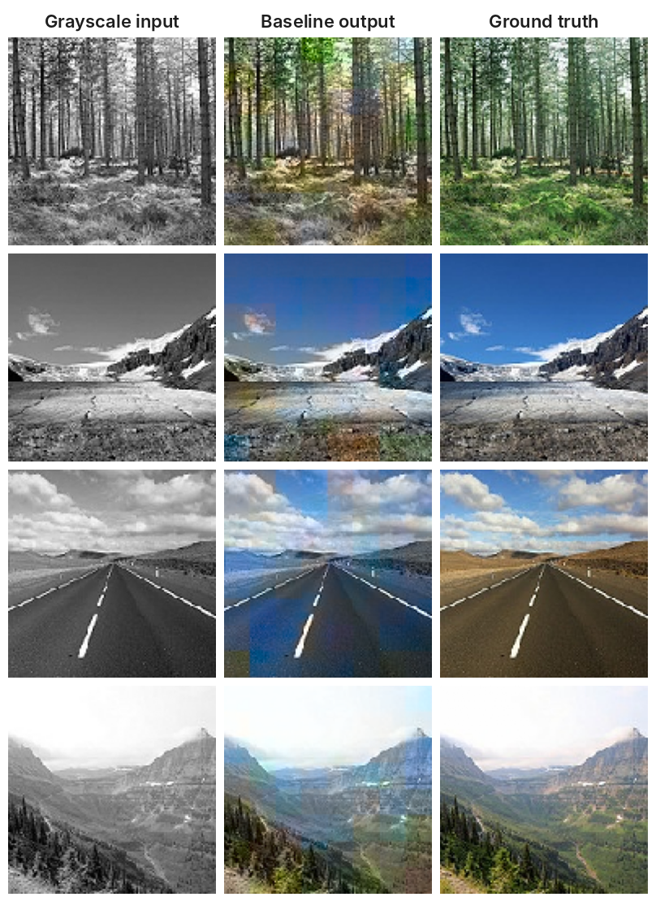
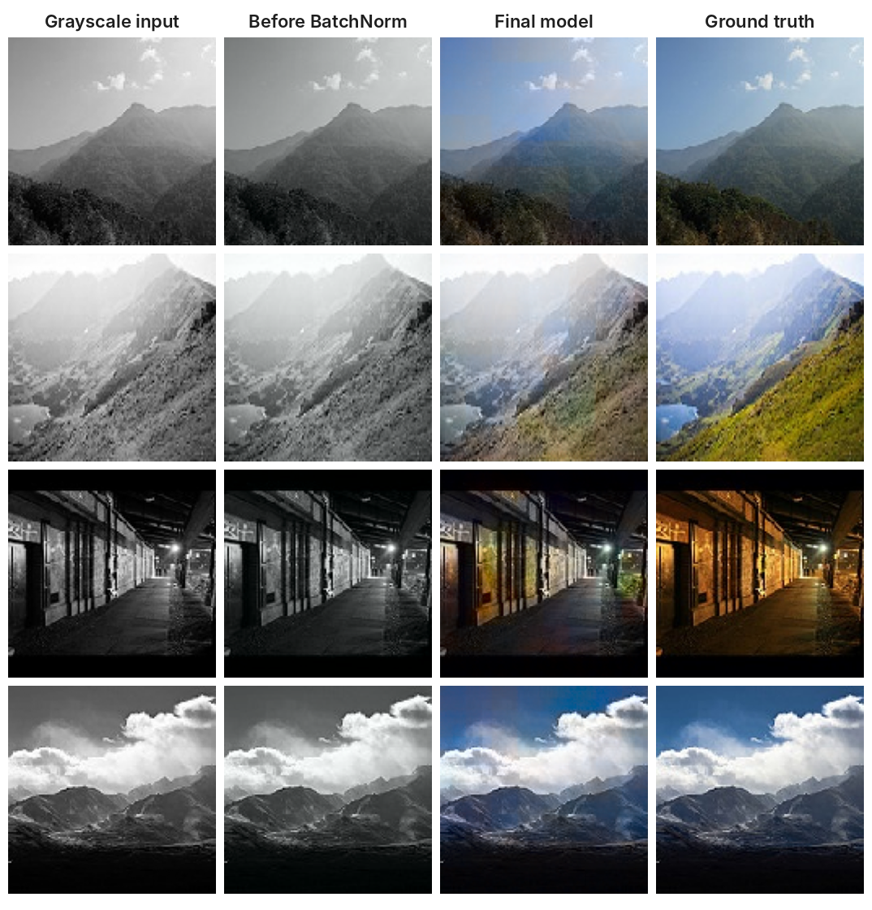
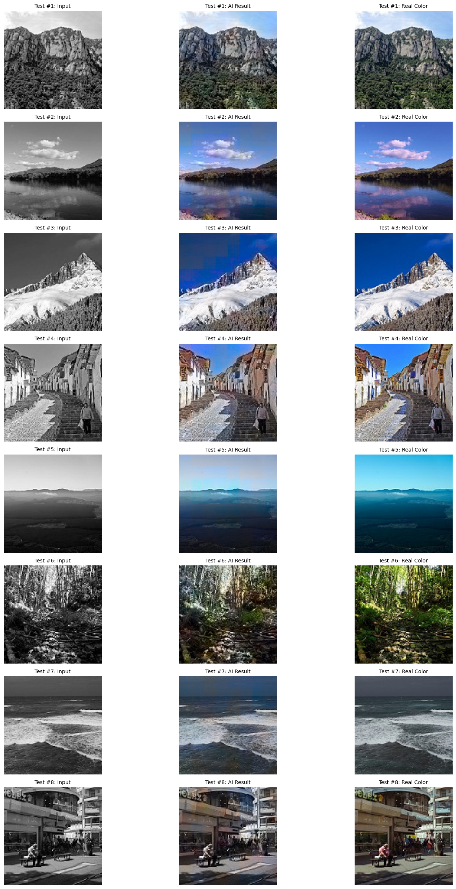

<div align="center">

# 🏞️ Landscape Image Colorization

### Bringing black-and-white landscapes back to color with a Convolutional Autoencoder

[](https://colab.research.google.com/github/LayanAlmashhourCodes/Landscape_Colorization_Autoencoder/blob/main/notebooks/landscape_colorization.ipynb)
[](https://www.python.org/)
[](https://www.tensorflow.org/)
[](LICENSE)


**PSNR 27.51 dB · SSIM 0.952** on 100 test images

</div>

---

## Overview

Colorization is an **ill-posed** problem: one gray value could come from a blue sky, a green field, or a brown rock. The model has to learn *context*: what a sky looks like, where vegetation usually sits, how mountains are shaded.

This project trains a **convolutional autoencoder** to do that for landscape photos:

- **Input:** the **L** (lightness) channel of an image in the [CIELAB](https://en.wikipedia.org/wiki/CIELAB_color_space) color space (a grayscale image)
- **Output:** the two missing color channels **a** (green ↔ red) and **b** (blue ↔ yellow)
- **Result:** the original L recombined with the predicted ab, converted back to RGB

The most interesting part of this project wasn't the final model. It was getting there: the first model **overfit**, my first fix made it **collapse into gray images**, and **Batch Normalization** finally got it producing real colors. The whole journey is documented below and in the [notebook](notebooks/landscape_colorization.ipynb).

---

## How it works

```
 RGB image ──► CIELAB ──► L (128×128×1) ──►  ┌──────────────┐        ┌──────────────┐
                                             │   ENCODER    │        │   DECODER    │
                                             │ Conv 64  /2  │        │ ConvT 256 ×2 │
                                             │ Conv 128 /2  │──8×8──►│ ConvT 128 ×2 │──► ab (128×128×2, tanh)
                                             │ Conv 256 /2  │  ×512  │ ConvT 64  ×2 │          │
                                             │ Conv 512 /2  │        │ ConvT 64  ×2 │          ▼
                                             └──────────────┘        └──────────────┘   L + ab ──► RGB 🎨
```

| Component | Details |
|---|---|
| **Encoder** | 4 × `Conv2D` (3×3, stride 2, ReLU): 64 → 128 → 256 → 512 filters, 128×128 → 8×8 |
| **Decoder** | 4 × `Conv2DTranspose` (3×3, stride 2, ReLU): 256 → 128 → 64 → 64 filters, 8×8 → 128×128 |
| **Normalization** | `BatchNormalization` after every conv layer (final model) |
| **Output** | `Conv2D(2, 3×3, tanh)`, matching the target range `[-1, 1]` |
| **Loss / Optimizer** | MSE on the ab channels / Adam |
| **Parameters** | ~3.14 M |

**Why CIELAB instead of RGB?** Lab separates *brightness* (L) from *color* (a, b). The model gets L for free and only has to predict 2 channels instead of 3. Because the original L is reused at the end, the output keeps every sharp detail of the input.

**Preprocessing**
- Images resized to **128×128**
- The dataset's `gray/` folder is ignored on purpose: extracting L from each color image gives a grayscale version that matches the target exactly
- `L / 100 → [0, 1]` and `ab / 128 → ≈[-1, 1]`

---

## 🗂️ Dataset

[**Landscape color and grayscale images**](https://www.kaggle.com/datasets/theblackmamba31/landscape-image-colorization) on Kaggle: **7,129** landscape photos (mountains, forests, roads, coasts, cities…).



---

## The journey: three models



### 1️⃣ Baseline: overfitting
**2,000 images · 100 epochs · batch 32**

Training loss kept falling to **0.0012** while validation loss stalled around **0.0095**. That gap is classic overfitting: the model was memorizing training images instead of learning general rules. Predictions on new images came out blotchy, with colored patches in the wrong places.



### 2️⃣ More data + Early Stopping: the "gray world" collapse
**5,000 images · Early Stopping (patience 10)**

The obvious fix was more data (2k → 5k) plus Early Stopping. It made things **worse**. Training stopped at epoch 15 with the loss flat at **≈0.0125**, and every output was essentially grayscale.

**Why?** With an MSE loss, guessing the wrong color (green when it's blue) is punished heavily. Guessing **a = b = 0** (gray) is only *a little* wrong everywhere. The network found that "safe" average, and Early Stopping ended training before it could get out of it.

### 3️⃣ Batch Normalization: real colors ✅
**5,000 images · 50 epochs · batch 64 · no Early Stopping**

Same architecture, with `BatchNormalization` after every convolution. Normalizing the activations keeps gradients healthy and neurons active, so the model pushes past the gray phase and starts committing to real colors.



---

## Results

Pixel "accuracy" isn't meaningful for a regression task like colorization, so two image-restoration metrics were used:

| Metric | What it measures | Score |
|---|---|---|
| **PSNR** | Pixel-level difference from the real image (20–30 dB is a good range) | **27.51 dB** |
| **SSIM** | Preservation of structure: edges, shapes, textures (1.0 = identical) | **0.9521** |

Final test on random images:

<details>
<summary><b>🖼️ Show 8 more examples</b></summary>
<br>

</details>

> **Honest notes**
> - SSIM is high partly because the L channel (all of the structure) comes straight from the input. The model only predicts color.
> - In the original notebook run, the train/test split wasn't strictly held out: the loader shuffled its own copy of the file list, while the test cells indexed the unshuffled list. So the scores above are **likely optimistic**. The scripts in [`src/`](src) fix this with a seeded split saved to `split.json`.
> - Batch Normalization fixed the gray collapse, but a train/validation gap is still visible in the curves. Reducing it further is listed under future work.

---

## Getting started

### Option A: Google Colab (easiest)
Click the **Open in Colab** badge above, choose a **GPU runtime**, upload your own `kaggle.json` when asked, and run all cells.

### Option B: Run locally

```bash
git clone https://github.com/LayanAlmashhourCodes/Landscape_Colorization_Autoencoder.git
cd Landscape_Colorization_Autoencoder
pip install -r requirements.txt
```

**1. Download the dataset** (needs a [Kaggle API token](https://www.kaggle.com/docs/api) in `~/.kaggle/kaggle.json`)
```bash
kaggle datasets download -d theblackmamba31/landscape-image-colorization -p data --unzip
```

**2. Train** (writes `models/colorizer.keras`, `split.json` and `history.json`)
```bash
python -m src.train --data-dir "data/landscape Images/color" --epochs 50
# baseline without BatchNorm:  add --no-batch-norm
```

**3. Evaluate on the held-out test images**
```bash
python -m src.evaluate --model models/colorizer.keras --data-dir "data/landscape Images/color" --samples 200
```

**4. Colorize your own photos** (a single file or a whole folder)
```bash
python -m src.colorize --model models/colorizer.keras --input path/to/photo.jpg --output outputs/
```

---

## Project structure

```
Landscape_Colorization_Autoencoder/
├── notebooks/
│   └── landscape_colorization.ipynb   # full experiment log with outputs (all 3 models)
├── src/
│   ├── config.py                      # image size, scaling, hyper-parameters
│   ├── data.py                        # loading, RGB ↔ Lab, train/test split
│   ├── model.py                       # autoencoder (with / without BatchNorm)
│   ├── train.py                       # training script
│   ├── evaluate.py                    # PSNR / SSIM on held-out images
│   └── colorize.py                    # colorize any image or folder
├── assets/                            # figures used in this README
├── requirements.txt
└── LICENSE
```

---

## ⚠️ Limitations & future work

| Limitation | Possible fix |
|---|---|
| Checkerboard artifacts from `Conv2DTranspose` | Upsampling + Conv, or sub-pixel convolution |
| Soft edges, fine detail lost in the 8×8 bottleneck | **Skip connections** (U-Net) |
| Desaturated, "averaged" colors (MSE favours the mean) | Classification over quantized ab bins, perceptual or adversarial (GAN) loss |
| Remaining train/val gap | Data augmentation (flips, crops), dropout, more images |
| Low resolution (128×128) | Train at 256×256, or upscale the predicted ab channels onto a full-resolution L |

---

## Tech stack

`Python` · `TensorFlow / Keras` · `NumPy` · `scikit-image` · `Matplotlib` · `Pillow` · `Google Colab (T4 GPU)`

## Acknowledgements

- Dataset: [theblackmamba31 / Landscape color and grayscale images](https://www.kaggle.com/datasets/theblackmamba31/landscape-image-colorization) on Kaggle
- Inspired by the colorization literature, especially [Zhang et al., *Colorful Image Colorization* (ECCV 2016)](https://arxiv.org/abs/1603.08511)

## License

Released under the [MIT License](LICENSE).
